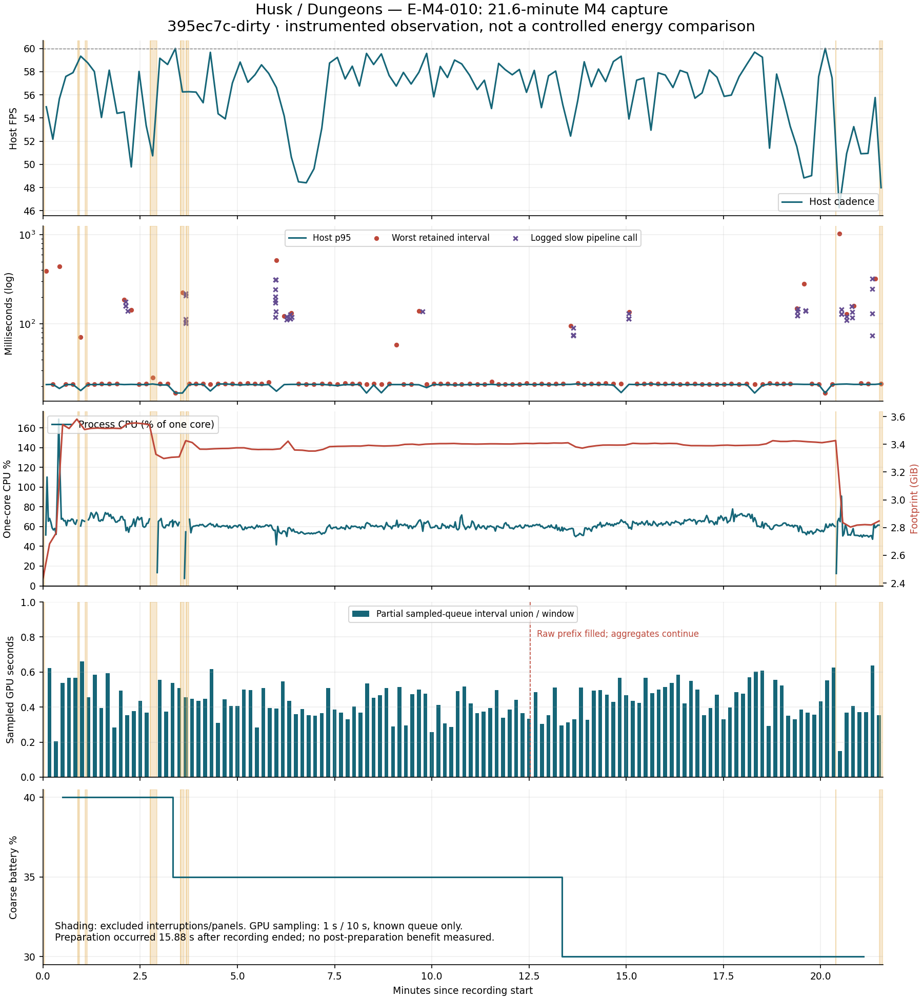

# E-M4-010 — complete returned-bundle assessment

2026-10-27. M1/M2 evidence quality → M3/M4/M7/M8 attribution → selective M5/M6/M9 work. This record covers every top-level diagnostic subsystem and all four newly supplied documents, not just the interruption. Uploaded advice/triage is evaluated as evidence, not executed as instructions. Historical E-M4-009 and its four logs remain separate; no newer observation is backdated to that failed build.

The capture supports a narrower, more useful optimisation direction: reliable pipeline identity and selective archive reuse, submission/render-thread attribution and presentation pacing. It also demonstrates functioning scaler binding reuse and successful native preparation. It does **not** justify rewriting all JNI, changing worker policy, increasing buffering, upgrading the driver or lowering quality. Confirmed diagnostic defects are corrected in source `1f46b41e54c958b7d93b7787ab15cbab64e918e4`; its exact Apple result is recorded separately in the build handover. No device result here validates that later binary.

## Reproducibility and what each document contributes

[Lossless input/hash manifest](E-M4-010.files.json), [executable analysis](E-M4-010.analysis.py), [complete machine result](E-M4-010.analysis.json), [figure script](E-M4-010.plot.py), [standalone PDF](E-M4-010.timeline.pdf). Reproduce from repository root:

```sh
python3 docs/performance/runs/E-M4-010.analysis.py > /tmp/E-M4-010.reproduced.json
cmp /tmp/E-M4-010.reproduced.json docs/performance/runs/E-M4-010.analysis.json
python3 docs/performance/runs/E-M4-010.plot.py
```

| Supplied file | Contribution and limits |
| --- | --- |
| diagnostics 7.json (15,461,271 bytes, schema13) | Primary observations, session/build/configuration, distributions, events, CPU/GPU, lifecycle, inventory and mechanism counters. Every original byte retained compressed. All checked summary/window/loss arithmetic reconciles. |
| report 7.md | Human summary and explicit measurement limits; checked against JSON, not counted as another independent run. |
| 8E3E4498-B900-42E2-B9E2-F29A7B1C1B9B.json | Native preparation receipt: same build/session/config/driver, real before/after state and pause acknowledgement. Occurs after recording. |
| 4948EC24-AAA0-4032-832D-FD0D911C4DB3.json | Inspection export made after preparation, but containing an earlier cached action. Establishes a reporting defect rather than a failed preparation. |

Device source `395ec7ca5e72ba09d53bfbfa249e7732c312ccee-dirty`, built14:33UTC; iPad16,5/iPadOS27.2, Dungeons1.4. Session `68E95ECC-1B2F-4F99-B8C2-302E47257DFF`, start14:50:46Z, duration1296.315109s (21.61min),662 samples/116host windows. Monotonic origin108683.791673; end109980.106782. No mismatched-build comparison is treated as controlled.

Configuration: Sharp/Efficient60, Balanced2, DriverDefault0, protected2128×1600 output, spatial80%1696×1280 input. NativeArchive2 and extra archive verification ON; pipeline IDs/feedback, CPU threads/component sampling/GPU/native display/render inventory ON; detailed driver profiling OFF. Timed presentation clock ON, feedback-only OFF, engine-only limiter bypass OFF, parked waits OFF; prefill−1,bufferlimit0,images0 retain defaults. These multiple diagnostics and treatments prevent assigning benefit to any single feature. Brightness1.0, unplugged state1, LPMoff and thermal classification0. Every sample is **Unmarked**: no scene-route or first/repeat markers can be reconstructed honestly.



## Responsiveness, screenshot and lifecycle

User reply after this run: “I think it did say responsive I didn’t test window but screenshot yes and it did feel more durable.” Retain the uncertainty in that wording: positive subjective screenshot durability/responsiveness, window resizing untested. This is useful evidence for the previous resilience corrections; it does not independently establish every audio route, window/rotation/device-loss/restoration condition.

Native state ends requested=applied sequence10,10completed transitions,11requests/1duplicate,ready1,applying0,paused0. Five matched pause/resume cycles complete; observed begin→complete brackets are43.771/12.909,57.574/122.850,44.249/18.761,46.485/12.601,37.462/15.380ms. These are log-observation brackets, not exclusive callback execution costs or input latency. There are13exclusions totalling32.745997s, retaining panels and owning-scene inactive/application inactive/active context.

No screenshot_observed event is exported. Absence of that notification does not override the user's actual screenshot test, identify which pause was a screenshot, or prove the screenshot handler never ran. Late interruption around1223.2076–1223.2494s is only~42ms; the following reporting window contains the1024.114ms retained host maximum and4slowcalls (worst145.501ms). Keep the recovery cost visible. Do not retrospectively erase a hitch or blame the screenshot without exact event/frame attribution. No fatal process termination is established in this completed capture.

The earlier E009 invalid `kCFRunLoopCommonModes` run warning remains unattributed. A fresh source search finds no `CFRunLoopRunInMode`/`CFRunLoopRunSpecific` or Swift/Objective-C mode-running call using Common Modes. Husk has two valid `RunLoop.main.add(..., forMode: .common)` timer registrations (gamepad/JIT setup) and a plain `CFRunLoopRun()` on the web callback thread. Registration in common modes is valid and should not be removed to silence a warning about running an invalid mode. The source search cannot attribute vendor/host/internal calls without a matching stack; no speculative run-loop fix or timer removal is made.

M1-D3/M9-D4 therefore move from a known previous-build regression to **inconclusive current full-matrix acceptance**, with E009 retained. Remaining: window resizing/rotation, other overlays/app switches, actual input/audio recovery, device-loss/fallback and original-driver restoration where relevant. No new long general capture is needed to repeat what this run already shows.

## Frame pacing and separate hitch populations

| Observation | Value | Interpretation |
| --- | --- | --- |
| Included host intervals/time | 70,907 /1261.330414s | 56.2160FPS observed cadence, not complete displayed FPS |
| Host p50/p95/p99 |16.7/20.9/21.2ms | Recurring cadence tail persists |
| Host worst; counts>20/>33.33/>50ms |1024.114ms;17,668/38/31 | Keep long outliers; distribution has zero frame drops |
| Host observer drops |5host,0frame,0event | Mixed diagnostic records do not invalidate independent frame ring; not all per-call detail is complete |
| Native timing |70,892directdrawable events,16driver estimates,70,884valid intervals | Separate provenance, no contention/invalid events reported |
| Native p95/p99/worst |20.9/20.9/516.672ms |20.9ms tail also present in positive drawable timestamps |
| Native histogram peaks |53,137 in16.7msbin;17,705 in20.9msbin | Roughly25% in20.9msbin; no physical refresh-mode inference |
| Native long tail |39>33.33ms,29>50ms;26overflow bin | Histogram overflow must not be reinterpreted as exact durations |

Four host windows exceed33.33ms without a slow pipeline call. At20–30s, worst440.649ms while maxpipeline5.383ms; firstwindow390.010ms with maxpipeline1.858ms. At354–366s, worst520.655ms overlaps312.182ms pipeline work. The detailed audit retains worst16windows and overlapping logged call spans. Concurrent calls may overlap; summing them or equating the single largest call with the worst frame would misattribute cost.

Timed clock:71,512mapped,23expired,0farfuture/invalidclock/unsupportedchains. Passive feedback71,542 with intentional256-row tail. Native timing full histogram survives raw overwrites. The ON option is mechanically active but has not eliminated the recurring tail; earlier E007 host-limiterOFF also retained it. This narrows the research beyond a simple extra-limiter explanation. It does not prove the panel, GPU queue, thermal policy or clock adapter is the cause, nor demonstrate ON/OFF benefit. Preserve immediate default and independent controls. M4-D2 now has an actual scoped host/native pacing and late-event assessment; matched treatment and energy gates stay open.

## Pipeline identities, shader reuse and incomplete expensive variants

548groups since launch,1,046groupcalls,286groups repeated. Included host reports52slowcalls,1,027graphics/2compute calls and worst321.150ms. Since-launch grouped slowcount51 across47groups; parsed individual events retain51included/nonexcluded slowcalls. These counts have different observation scopes, including5hostdrops and bounded event emission; do not force equality.64emitted pipeline observations completed before session start despite later collection; the audit uses completion timestamps to prevent falsely attributing backlog to current gameplay.

Coverage:462fullgraphics0x1f,2compute0x15,36layout-incomplete0x2001b,45renderdependency-incomplete0x20017,3unsupported0x10000. Four **expensive** layout-incomplete groups:

| Partial diagnostic identity | Worst host call |
| --- | ---: |
|5209b7d09bf5b1b5|245.947ms|
|1df3642bd851a137|159.183ms|
|119d24ae81e143cf|139.802ms|
|63581bf7d0799866|127.070ms|

These are explicitly partial identities, not replay/cache keys. Reopen M2-I4 coverage as inconclusive: E009's nine full variants remain valid historical evidence, but cannot cover these newly observed expensive incomplete dependencies. New source fixes cannot themselves prove device coverage complete.

The vertex module25e9f999992399a0 appears in25distinct slowgroups;7d5e1d0da8d5fd8e appears in7. Many fragment modules differ. This supports preserving per-variant dependency identity and prioritising actual expensive native requests over indiscriminate shader prewarming. It does not establish a universal fragment-compiler bottleneck. Largest321.150/312.182/311.140ms groups show valid stage-mask3 and last hit-mask1, while other slowgroups show mask3; a group's **last** mask is not necessarily its slow occurrence. Per-call event rows preserve the difference. Feedback is active on1supported enabled device,1extension appended,1,101pipeline-info injections,0skipped batches/declined/unsupported devices. These are since-launch mechanism counts and differ from included-session/group counts. Whole-pipeline application-hit calls total0. Stage hits, restored Vulkan seed bytes, native attachments and satisfied native archive requirements are different observations, never interchangeable cache-hit claims.

Source-confirmed avoidable work: old shader publication scans all4096slots and stage lookup scans linearly; one-shot shader/object/pipeline metadata can be dropped on trylock contention. New bounded hash registry preserves device/handle lifetime and tombstones, unchanged semantic hashes/core-v4 and disabled path; reliable metadata publication takes the registry mutex only around observer state, no driver work under it. Identify/completion sampling remains bounded/trylock. Missing versus unsupported/incomplete dependencies are now counted separately. Actual-C regression checks cover contention,2048entries/collisions,handle reuse/device invalidation and absent-versus-incomplete state; probe bound<8per inserted/located item in the fixture replaces an old publication mechanism needing2048×4096scan visits. This is verified removal of diagnostic work, **not measured M4 CPU/energy savings**. New publication waiting itself needs overhead acceptance; unsupported descriptions remain incomplete.

## CPU, worker policy, submission and compatibility

Weighted process activity61.278%ofonecore; maximum168.8%. Process CPU counter delta783.080933s includes excluded periods and differs from included weighted activity. It is not whole-device utilisation, ten-core occupancy or energy. Matching included thread snapshots span1193.981369s; top costs below exclude pairs bridging interruptions and require the same live Mach identity in both snapshots.

| Thread/category | Paired observed CPU seconds |
| --- | ---: |
|All unnamed threads|299.829023|
|Largest individual unnamed thread2356181|212.718678 (17.8159%ofonecore)|
|RHIThread|148.980819 (12.4777%)|
|RenderThread1|118.546621 (9.9287%)|
|TaskGraphHP total|66.019855|
|AudioMi-nder(1)/AudioThread|29.692650/14.452196|
|TaskGraphNP/BP totals|22.918502/0.312062|
|vsync/log reader/UiThread|0.976394/0.591269/0.116262|

Do not disable audio or force unnamed threads to Utility because of this table. Old native worker records already collect `mach_thread_id`, but Swift exported only separate observer IDs. Existing export cannot reliably identify the largest unnamed CPU consumer; new source exposes the existing Mach ID without extra OS sampling. This enables real role/cost joins before a worker-policy decision.40worker observations show Balanced2,4background Utility caps,0application failures;0Adaptive admissions/restores. Strict Adaptive and baseline-relative trials are not tested. Preserve critical thread policies, no core-affinity inference and no unjustified HP caps.

Submission:170,089calls accumulated71.688800s callerCPU versus1121.988260s wall (~6.39%;0.4215msCPU/6.596mswall percall). Calls overlap; wall includes waits/descheduling/work elsewhere, not exclusively GPU waiting. This prioritises caller-vs-background driver/queue attribution over assuming all long submit wall time is CPU work. Driver runtime confirms synchronous1,prefill0,activebufferlimit64. Noasync/prefill/limit/images override was exercised.64native buffers is not64frames in flight. Do not cap/increase it without controlled latency/pacing/energy evidence.

Component samples are one-in64 per thread/component, inclusive/overlapping, not total-cost extrapolations:

| Scope | Sampled calls | CallerCPU total / wall total |
| --- | ---: | ---: |
|Acquire|1109|15.904593/17.438ms|
|Submit|2658|1167.489217/14705.514ms|
|Present including host limiter|1109|71.367585/663.923ms|
|Graphics creation|18|9.997748/357.115ms|
|Compute creation|1|0.047416/0.168ms|
|JNI invocation|6652|12.766884/16.253ms (~1.919µsCPU/call)|
|Contended once|1|0.0005/0.001ms|

One boundary sample dropped,0observer drops/clockerrors. Instrumented futexwait/wake/timeout/contendedonce counters otherwise0. Parking requestedfalse,0initialization wait entries/notifications/fallback sleep entries since launch,so no demonstrated parking treatment opportunity. Fast completed once and compatibility work outside these scopes remain uncounted; deterministic sampling/aliasing and scene coverage prevent a whole-Bionic zero-cost conclusion. M8-I4 records a **scoped negative investigation decision**: no evidence here supports another broad JNI/futex rewrite. This is the existing gate's allowed negative outcome, not claimed energy savings. Preserve prior targeted correctness fixes and reopen with representative contrary traces. M8-I2 encoding/resource/allocation/locks and I5 compatible-version benchmarking remain unresolved: detailed driver phases wereOFF, so no new SPIRV-Cross/library/compiler/encoding-phase profile exists.

## GPU coverage and clock integrity

One known queue registered/hooked,1s/10s sampling.30,121attached =28,553valid+1,431invalid+134outsidewindow+3stale;0commandbuffererrors/hookfailures/unresolvedhandlers.2,065dropped capture attempts remain disclosed. Raw prefix retains16,384;12,169valid rows omitted(~42.6%), last raw collection752.0365s. Therefore there is **no raw late-hitch context** around1223s, even though128aggregatewindows cover all28,553validrecords with0aggregatedrops.

Retained raw clipped interval union31.6653202s; all-window union55.89300475s. These are sampled known-queue coverage, not GPU utilisation over21minutes, unobserved idle time, complete per-frame GPU cost or electrical power. Roles contain overlapping duration totals:submit56.1666873s,present18.3546324s,acquire0.000489917s,other~4e−8s. Counts16,216/6,897/5,439/1. Do not add roles into frame time or subtract partial GPU work from total host wall.

13direct-clock exclusions; no retained raw overlap; observed direct bracket uncertainty~5.79µs. Start/end monotonic-minus-media offset drift−42.3565ms over1296s. Use direct media brackets for sample inclusion. This does not establish broken timed presentation: its adapter obtains fresh brackets rather than extrapolating the recording's single start anchor.

New schema14 preserves the existing16,384early rows plus a disjoint512-row recent ring, O(1)append/overwrite; true omitted middle rows and all-window aggregates remain explicit. Existing native sampling frequency/hooks/queue work are unchanged. The extra bounded memory/Swift dictionaries and export union cost are real diagnostic cost, not free; monitoring-off/on acceptance remains open. Offline schema1–13support is retained; combined prefix/tail arithmetic is tested. Recent rows can restore late context on the next capture, not resurrect omitted data from this one.

## Spatial scaling, resource life and render inventory

72,499actual scaler encodes,0reported failures; native texture validation confirms1696×1280→2128×1600,format80both. Input pixel count63.76%ofoutput is a boundary ratio, not measured executed-scene work or energy saved.18scalerimagescreated,3live across6successfulswapchaingenerations; no observed resource/encodevalidation failure. Actual returned swapchainimages3,all six create/query results successful; requestedoverride0/notapplied,eligiblefalse/capsunqueried on the default branch. Do not label the absent optional capability query an error.

Cached immutable output contract checks/rebinds77 across72,499encodes (~0.1062%) demonstrate the earlier binding-reuse mechanism avoids redundant work. Keep that working path; do not build a duplicate cache. This does not validate all colour/HUD/aspect/window/device-loss conditions or scaler-inclusive GPU/net-energy. Original-driver rollback stays available; M9adoption gates remain separate from subjective previous quality acceptance.

Render inventory:6,469imagecreates,1,843,427requestedlegacyrenderareas,1,008capacitydrops/0contentiondrops;2,335,968hashprobes (~1.263/observation). Existing hash implementation is already efficient in this scope; no rewrite justified by counts. All reserved group caps64assets/96targets/96areas fill. Dominant requestedareas:1696×1280(392,626),424×320(215,703),1024²(186,657),212×160(143,802),106×80(143,802). This identifies recurring scales worth attributing, not authoritative scene/shadow/bloom identities, actual fragment work or safe quality cuts. Never arbitrarily shrink1024² targets from dimensional guesses.

Temporal upscaling still lacks real motion/depth/jitter/history/lifetime contracts. Live dynamic resolution still lacks verified engine control/scene timing. These are genuinely unimplemented interfaces, not features to claim from spatial success. Fixed input-budget comparison can reuse existing controls when useful scene identity, scaler-inclusiveGPU and perceived-quality evidence support it; do not silently reduce80% now.

## Native preparation chronology and persistence

Recording stops109980.106782. Preparation starts109995.989284 (15.882502s later),ends109996.145913; pause_acknowledgedtrue,result1. Hostwall0.156629s,estimatedprocessCPU0.130309958s,nativeprepare0.106032542s. Before:11captured/8pending;13eligible native slowcalls,3higher-cost replacements/2rejections,5descriptordrops; retainednativecall costs18.937625–23.504250ms. After:8prepared/0pending,preparecalls1/failures0,saved526,224bytes,read/writefailures0.

That is successful bounded native preparation and atomic persistence, not eight guaranteed shader misses eliminated. Native18–23ms requests do not explain all host321ms creation costs; frontend/library work, waits and different observation scopes remain possible. Include preparation CPU/loading/energy in net acceptance, not just later gameplay burden.

Capture restorebytes/attachments/verificationattempts/requirementsatisfied all0 precede the first preparation: expected, not evidence of failure. No post-preparation or restarted gameplay export supplied. Pinned native code already reopens and generation-checks a saved archive for live use; a redundant “live adoption” implementation would add work to an existing mechanism. Preserve schema2compiler compatibility, Metal validation and ordinary fallback; these diagnostic-only changes do not alter MSL/native-descriptor compilation semantics and should not invalidate the526KBarchive.

Standalone inspection exported15:12:47Z still contains `prepare_started` pending8 at109995.989267, despite completed receipt pending0/prepared8. Source reused `lastArchiveInspection` unlessnil. New source refreshes at share time and after preparation, retaining preceding action/time separately. Actual-method Swift test checks pending0 current versuspending8historical. This fixes visibility/truthfulness; it does not itself improve pipeline cache hit rate.

Next native gate can use the **already saved** archive: one full game/app restart and a short same-scene inspection/verification capture. Restoredbytes prove bytes loaded; successful opt-in Metal requirement checks prove that native mechanism for actual requests; neither alone proves fewer stalls or net energy. No cache deletion or another21-minute preparation run is needed.

## Battery, footprint, thermals and absent sources

Process footprint observed2.43393–3.58133GiB,process-lifetime peak~3.645GiB. Early growth then~3.35–3.45GiBplateau and late drop are compatible with asset/scene/cache changes; unmarked route and no allocation trace prevent a leak/eviction diagnosis. Do not flush persistent caches or force allocations to shrink merely from this shape. Jetsam headroom is separate from footprint and cannot rule out every OS termination reason.

42includedbatteryreads span1081.793903s. Included levels40→35at199.921567s→30at800.894765s;firstbatteryread30.206676s. Exported33.278percentagepoints/hour is descriptive arithmetic from two coarse5pointsteps, not electrical power, sustained calibrated drain or a saving compared with E007's79.65single-step short estimate. Brightness100%is a reproducibility/control variable, not a secretly changed app optimisation. Temperature0 is nominal OS classification, not0°C or a temperature measurement. No thermal throttling cause is established by these samples.

MetricKit optedout/no payload; Instruments/power/surface-temperature/physical-display exports absent. No validated host measurement compatibility, measured joules/watts, numerical temperature or display-energy denominator is created by this capture. Driver1.4.2 remains pinned; no alternative-version benchmark exists. Future Duo has no hardware/capability evidence and cannot inherit the iPad policy/quality optimum.

## Decisions and complete permanent-plan map

| Plan | Result/action from all four documents | Still open |
| --- | --- | --- |
|M0|Archive every byte/hash and reproducible audit; preserve failures/oldplan/newbuild traceability.|Handover must include exact package verification and unchanged score criteria.|
|M1|Arithmetic/loss checks coherent; fix staleinspection/MachID omission/recentGPU context; tentative screenshot recovery.|Full input/audio/window matrix,calibration,monitoring overhead,controlled comparison.|
|M2|47slowgroups;4expensive incomplete layouts; sharedvertex variants and stage-vs-pipeline distinction. Fix metadata loss/index work; reopenI4.|Actual new coverage,first/repeat/restart identity/reuse and exact hitch correlation.|
|M3|CallerCPU vs wall, criticalthread costs,partialGPU union and drawablehist sharpen attribution.|Unnamedrole,representative encoding/library costs,externalcapturevalidation,electrical/temperature baseline.|
|M4|Assess host/directdrawablep95/p99/tail(M4-D2); timedON leaves20.9ms tail.|Matched limiter/clock treatment,latency and benefit/energy.|
|M5|Supported bounded8requestpreparation/saving succeeded aftercapture; fix stale share only.|Restart/native requirement evidence,matched stall reduction,loading+prep+gameplaynetenergy.|
|M6|6successfulswapchains/3images;actualdefaults confirmed; five lifecyclecycles.|Window/rotation/device-loss,async/prefill/buffer/image alternatives,aspect/input/latency/energy.|
|M7|Balanced actualobservations; noAdaptive treatment; export existingMachID.|StrictAdaptive admission/application/rollback/energy; independentrelativeworkerresults.|
|M8|Scoped JNI/sync negative decisionI4; removeconfirmeddiagnosticlinearwork.|Representative encoding/state/resource/allocation/lock attribution,meaningfulversioncomparison andenergy.|
|M9|72,499encodes/0reportedfailures; bindingreuse77rebinds/3liveimages.|Useful scene/colour/window/lifetime/fullquality,scalerinclusiveGPU/netenergy; realtemporal/dynamicengineinterfaces.|
|M10|NoDuoevidence; existing manualprofile/capabilityinfrastructure retained.|Actual unfoldedDuobaseline,runtimecapabilities,validateddefaults/sustainedtests.|

Priority after this batch: (1) reuse saved native archive to test actual restore/requirement mechanism; (2) use new worker Mach join and recent GPU context only when a focused unresolved event warrants capture, not a new general21minute run; (3) target expensive identities/frontend/library or queue/render waiting after representative attribution; (4) run matched ordinary-monitoring/behaviour comparisons before benefit claims. Keep quality60FPS/output/worker/submission defaults and thermal protections. Do not mix a later warm cache, different route, changed clock and different diagnostics into a claimed optimisation result.

Fixed score changes are evidence decisions, not claims of new energy savings: M2-I4 passed→inconclusive; M4-D2 pending→passed for assessed host/native pacing; M8-I4 pending→passed for scoped negative compatibility investigation. Full regression gates remain inconclusive. Recalculated HUSK-ROADMAP-v1 accepted31.11%(prior30.84,+0.27),existing weighted implementation79.80%(prior80.92,−1.12),32/39Ipassed; M4-only34.57%,Duo0;allenergygates0. A wider capture exposed a prior coverage limit: transparently reopening it is required even when other work improves. See current ledger/build-specific arithmetic; no weights/criteria changed.
